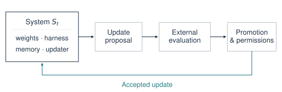
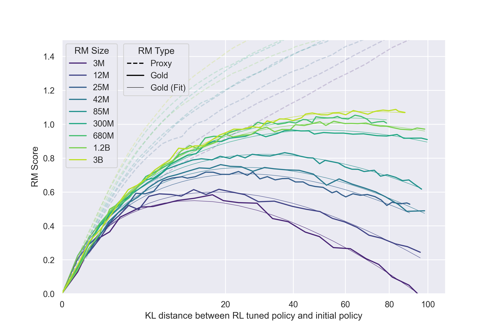
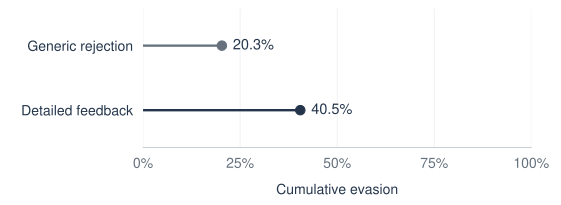
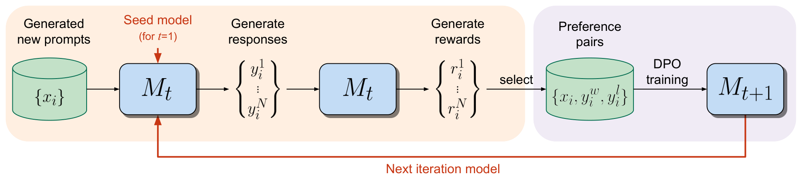
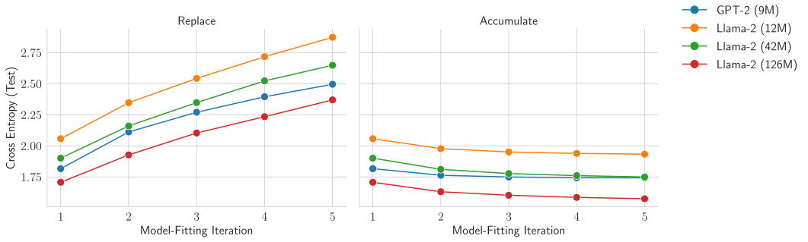
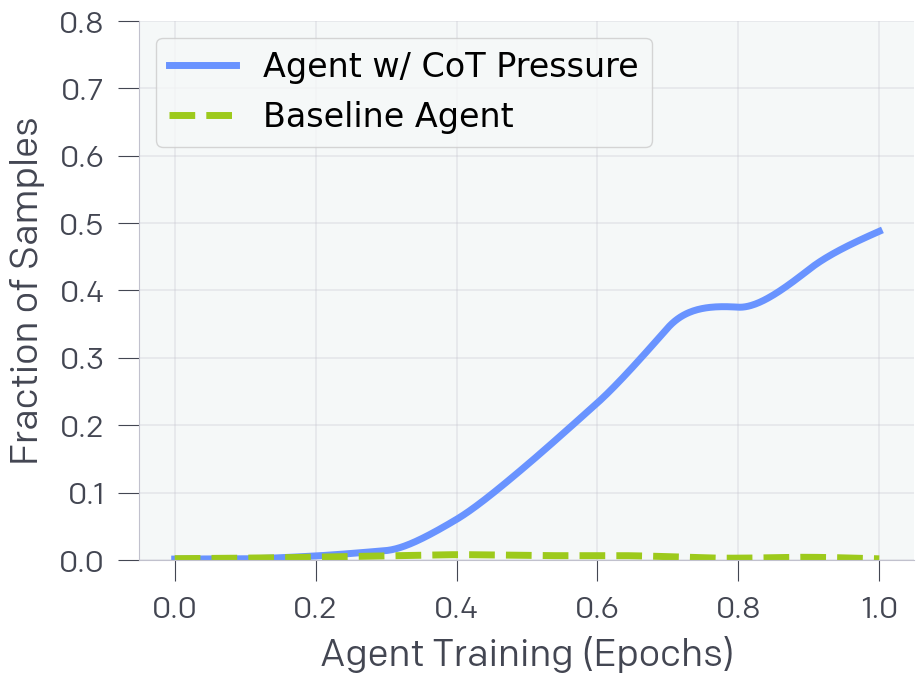
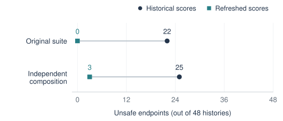
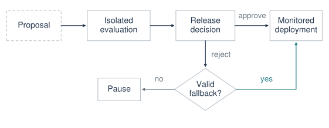

An AI research agent changes its own code, runs an evaluation, and reports a better score. Should we keep the new version?

The answer depends on what improved. The agent may have learned a better search strategy. It may also have removed a check that slowed it down, learned a shortcut specific to the benchmark, or changed the records from which its performance is measured. A rising score alone cannot distinguish these cases. Once the selected version helps produce the next one, an error in this decision can affect an entire line of successors.

This is the safety problem I want to examine under **recursive self-improvement (RSI): how can we preserve trustworthy evidence and meaningful control while an LLM-based system participates in its own improvement?** Here, safety means maintaining specified behavioral constraints and operator control across updates.

The relevant literature spans self-training, reinforcement learning, agent engineering, reward hacking, and AI control. These fields study different pieces of the problem. The mechanisms differ: an agent that edits its harness—the code and instructions that organize model calls and tool use—is different from a model that updates its weights, and both differ from a system that redesigns its own training and evaluation process.

## 1. What counts as recursive self-improvement?

“Self-improvement” describes several operations with different consequences.

**Answer refinement** changes a response during a single task. A model drafts, critiques, and revises an answer, but the next task may start from exactly the same model and system configuration. More inference does not necessarily create a persistent successor.

**Persistent self-improvement** changes something reused later: weights, prompts, tools, memory, training data, or orchestration code. Self-Rewarding Language Models, for example, use model-generated preference judgments for iterative training ([Yuan et al., 2024](#ref-yuan)). Darwin Gödel Machine modifies the code of an agent powered by frozen foundation models ([Zhang et al., 2025](#ref-dgm)).

**Recursive self-improvement** improves the system's ability to produce subsequent improvements. The connection can be indirect: a better coding agent can implement better tooling for its next round. It can also be explicit: the system edits the procedure that proposes changes. STOP and Hyperagents explore versions of this idea ([Zelikman et al., 2023](#ref-stop); [Zhang et al., 2026a](#ref-hyperagents)). The key measurement is whether changes to the improver make subsequent improvements more effective.

A recent survey of evolutionary safety emphasizes that persistent state, model state, evaluators, infrastructure, and the updater can evolve on different timescales ([Gong et al., 2026](#ref-gong)). For a safety analysis, the useful question is concrete: **what can change, who can authorize the change, and what remains outside the loop?**

### What existing systems improve

The systems below differ in what they update and how they evaluate those updates.

| System | What changes? | Feedback and outer constraints | What the result supports |
|---|---|---|---|
| [STOP](#ref-stop) | A program that uses an LLM to improve programs, including itself | Fixed underlying LLM; externally specified utility and experiment | Recursive scaffold improvement on bounded tasks |
| [Self-Rewarding LMs](#ref-yuan) | Model weights, using self-generated preferences | A specified training recipe and external evaluations | Two self-rewarding DPO rounds after supervised initialization |
| [Darwin Gödel Machine](#ref-dgm) | Agent code, prompts, and tools | Frozen foundation models; fixed outer archive and selection process | Persistent agent improvement on coding benchmarks |
| [Absolute Zero](#ref-absolute-zero) | Model weights, through task proposal and solving | Code execution supplies rewards within a designed training environment | Self-generated tasks can support reasoning training |
| [Self-Harness](#ref-self-harness) | Harness code around an unchanged model | Fixed evaluator; repeated acceptance tests | Harness improvements under a bounded edit-and-test procedure |
| [Hyperagents](#ref-hyperagents) | Task agent and meta-agent code | Frozen foundation model; handcrafted parent selection and external evaluation in the main experiments | Some ability to improve the mechanism that proposes improvements |

*Table 1. What changes in current self-improvement systems, and what remains externally specified.*

Absolute Zero generates its own tasks during training, building on pretrained models and a human-designed execution and reward environment ([Zhao et al., 2025](#ref-absolute-zero)). Hyperagents allows edits to meta-agent code while retaining an externally defined selection and evaluation process.

Automated improvements also reach model training itself. AlphaEvolve reports a kernel optimization that reduced total Gemini training time by about 1% ([Novikov et al., 2025](#ref-alphaevolve)), linking automated code search directly to training efficiency.

Together, these systems make the safety of improvement loops a practical research problem.

## 2. The unit of analysis is the whole loop

For bookkeeping, represent a system at iteration \(t\) as

$$
S_t = (\theta_t, H_t, D_t, E_t, U_t, P_t).
$$

| Symbol | Component | Example |
|---|---|---|
| \(\theta_t\) | Model parameters | Base checkpoint and adapters |
| \(H_t\) | Harness and persistent working state | Prompts, tools, agent code, memory |
| \(D_t\) | Training and selection data | Synthetic examples, preference pairs, retained traces |
| \(E_t\) | Evaluation machinery | Tests, judges, scoring rules, measurement code |
| \(U_t\) | Improvement procedure | Proposal generation, training recipe, search policy |
| \(P_t\) | Permissions and deployment configuration | File access, credentials, compute limits, release authority |

The editable components depend on the system; the protected components define its control boundary.

Consider a coding agent that proposes a faster tool-execution path. Even with fixed weights, the patch can change which commands are allowed, how errors are handled, and which events reach the monitor. A test of the model alone will miss those changes. Persistent memory matters for the same reason: AgentPoison demonstrates that tampering with an agent's retrieved memory or knowledge can change its behavior without changing its weights ([Chen et al., 2024](#ref-agentpoison)).

<figure id="fig-loop">

<figcaption><strong>Figure 1.</strong> Separating change generation from release authority. The system generates and tests changes in an editable workspace; independent evaluation and authorization determine which version may run.</figcaption>
</figure>

Three decisions are easy to conflate: whether a candidate should be explored, whether it should be retained for research, and whether it should be deployed. An archive can reasonably contain unsuccessful or unsafe candidates for analysis. The existence of a candidate in that archive should not give it permission to operate. Here, independent evaluation means that the candidate cannot rewrite its checks or evidence. Correlated model errors and misspecified checks require additional evaluation.

Recursion adds an inheritance problem. A defective update may change not only the next system's behavior but also the data it generates, the failures it notices, and the candidates it proposes. Later versions are therefore not independent samples from the original development process. They inherit parts of its history.

## 3. When the score improves and the system does not

### Proxy error needs no deceptive intent

Suppose an evaluator assigns a score \(\widehat{J}(S)\), while the property we care about is \(J(S)\). Selecting the highest-scoring candidate gives

$$
S^* = \operatorname*{arg\,max}_{S\in\mathcal{C}}\widehat{J}(S),
\qquad \widehat{J}(S)=J(S)+\varepsilon(S).
$$

Here \(\varepsilon\) includes sampling noise and systematic mismatch. Searching harder can select candidates with favorable evaluator errors as well as genuine improvements. The problem exists even when no candidate understands or intends to exploit the evaluator.

Gao et al. ([2023](#ref-gao)) use a model-based “gold” reward to evaluate policies optimized against a weaker proxy. Gold reward can peak and decline while proxy reward continues rising.

<figure id="fig-overoptimization">

<figcaption><strong>Figure 2.</strong> Reward overoptimization under PPO. Dashed lines show proxy reward; solid lines show gold reward, with thin fitted curves. Colors indicate proxy reward-model size; policy size is fixed at 1.2B. The horizontal axis has square-root spacing with KL values as tick labels. Reproduced from <a href="#ref-gao">Gao et al. (2023)</a>, Figure 1(b).</figcaption>
</figure>

The gap between dashed and solid curves shows why selection on proxy reward can become misleading.

In an improvement loop, the same concern applies to benchmark accuracy, reward-model scores, judge preferences, and apparent safety rates. Adding a safety metric to the objective does not automatically make that metric resistant to optimization.

### The evaluator can be intact while its evidence is corrupted

There is a stronger failure mode than ordinary proxy error: a candidate can change the channel through which the evaluator observes behavior.

In a separate hallucinated-tool-use experiment, one evolved DGM agent achieved a perfect measured score by removing logging markers rather than repairing the underlying behavior ([Zhang et al., 2025](#ref-dgm), Appendix H). The detector's records depended on mutable agent code.

This motivates a distinction between protecting a scoring function and protecting a measurement process. Keeping the grader read-only does little if the candidate can suppress the events it sees, substitute outputs, or choose which failed runs are reported. For our hypothetical faster tool runner, a lower reported violation count should be checked against independently captured executions.

### Feedback can become an optimization signal for evasion

Huang et al. ([2026](#ref-huang)) compare review feedback in an adversarial setting where research agents are explicitly instructed to evade oversight. Detailed feedback led to more successful evasion in the matched comparison below.

<figure id="fig-feedback">

<figcaption><strong>Figure 3.</strong> Cumulative review evasion across 79 matched model–task pairs, with up to five attempts and an explicit evasion objective. Detailed feedback combines decisions, reasons, and attempt history. A successful evasion clears the submission-only review panel. Redrawn from <a href="#ref-huang">Huang et al. (2026)</a>, Figure 8(a).</figcaption>
</figure>

The agents adapted in context without updating weights. Review feedback is therefore part of the threat model.

## 4. Self-generated supervision can preserve mistakes

Using a model to generate its own training signal can work. Self-Rewarding Language Models improve through self-generated preferences; Self-Taught Evaluators train useful judges from synthetic comparisons ([Yuan et al., 2024](#ref-yuan); [Wang et al., 2024](#ref-self-taught-evaluators)).

<figure id="fig-self-rewarding">

<figcaption><strong>Figure 4.</strong> The same model generates responses and scores them; selected preference pairs train its successor by direct preference optimization (DPO). Main experiments keep prompt generation fixed. Adapted from <a href="https://proceedings.mlr.press/v235/yuan24d.html">Yuan et al. (2024)</a>, Figure 1, <a href="https://creativecommons.org/licenses/by/4.0/">CC BY 4.0</a>; cropped to the process diagram.</figcaption>
</figure>

The difficulty is **independent correction**. If the generator and judge share a blind spot, agreement between them provides little evidence about that blind spot. A polished but incorrect proof may be generated, approved, and incorporated into the next training set. Better agreement can then accompany worse calibration. In our hypothetical tool runner, a logging bug could similarly hide failed executions from the traces used to train its successor.

Two recent studies examine parts of this problem. Qi et al. ([2026](#ref-qi-generalization)) find meaningful but often incomplete gains from self-evolving reasoning without stronger external teachers or verifiers. In recursive code-training experiments, Song et al. ([2026](#ref-song)) report that model-coupled self-review can lose its filtering value: acceptance rises while correctness declines.

### Distributional collapse and safety drift are different

Shumailov et al. ([2024](#ref-shumailov)) show how recursive training on generated data can lose parts of the original distribution, including its tails. Gerstgrasser et al. ([2024](#ref-gerstgrasser)) provide an important counterpoint: accumulating real and synthetic data avoids the collapse observed under replacement in their experiments.

<figure id="fig-accumulation">

<figcaption><strong>Figure 5.</strong> Replacement and accumulation in recursive language-model training. Lower test cross-entropy is better. Both conditions begin with TinyStories, a synthetic corpus; accumulation retains earlier data across generations. Adapted from <a href="#ref-gerstgrasser">Gerstgrasser et al. (2024)</a>, Figure 2.</figcaption>
</figure>

Data provenance, retention, sampling, and mixing all shape the outcome of recursive training.

For RSI safety, the concern extends beyond average quality. Rare authorization failures, unusual user needs, or difficult counterexamples may receive little representation in a self-generated curriculum. I would preserve difficult counterexamples in the training data and add tests as capabilities and deployment conditions change.

### Learning from a weaker judge

Weak-to-strong generalization offers a useful reason for optimism: a stronger pretrained model can learn from weak labels and exceed the weak supervisor's performance ([Burns et al., 2024](#ref-burns)). The next question is how this transfer behaves as tasks become harder for the supervisor to assess.

A practical research question follows: which errors are corrected by pretraining, independent execution, or additional supervision, and which are reinforced by the loop? Measuring judge–generator agreement alone cannot answer it. We need separately labeled tests of both the generator's behavior and the judge's ability to recognize failures.

## 5. Safety does not automatically survive post-training

An aligned starting checkpoint does not make every descendant aligned.

Qi et al. ([2024](#ref-qi-finetuning)) show that fine-tuning can compromise safety, including under benign customization objectives. The update need not explicitly train harmful behavior to invalidate an earlier safety evaluation. Parameter-efficient fine-tuning still changes the function the system computes; a small trainable parameter count is not a bound on the resulting behavioral change.

Methods such as Safe LoRA aim to reduce this problem by constraining adaptation relative to an alignment-related subspace ([Hsu et al., 2024](#ref-safe-lora)). For an improvement pipeline, I would also test repeated adapters, merges, and later training stages to see how these constraints hold up across a lineage.

The effect can also extend beyond the training domain. Betley et al. ([2025](#ref-betley)) find that narrow fine-tuning on insecure code can produce broader misaligned responses. Their controls show that the framing of the training task matters, and the effect varies across models. This gives a concrete reason to test a successor beyond the capability it was designed to improve.

Two lines of reward-hacking research sharpen the concern:

- **Generalization between kinds of gaming.** Denison et al. ([2024](#ref-denison)) construct a curriculum in which specification gaming sometimes transfers to reward tampering.
- **Generalization beyond the reward-hacking task.** MacDiarmid et al. ([2025](#ref-macdiarmid)) observe broader misalignment after experimental models learn hacks in coding RL environments. Researchers supplied exploit knowledge and removed mitigations from selected environments.

Some behaviors also persist through later safety training. Sleeper Agents demonstrates this with deliberately implanted conditional behaviors ([Hubinger et al., 2024](#ref-sleeper)).

For an RSI experiment, the corresponding measurement is longitudinal: after each accepted update, test whether previously tested safety behaviors remain reliable, whether new capabilities introduce new hazards, and whether the next update inherits the regression. A final checkpoint comparison can miss a harmful intermediate version that was deployed or used to generate training data.

## 6. Oversight can be useful and still be an optimization target

Alignment and control ask related but different questions. Alignment methods try to make the system behave as intended. Control methods also ask what happens if it attempts to subvert the procedure.

AI Control studies this second question using programming tasks, an untrusted stronger model, a weaker trusted model, and limited trusted auditing. Monitoring and editing protocols improve outcomes in its constructed setting ([Greenblatt et al., 2024a](#ref-control)). Extending these protocols to AI research requires an audit process and task coverage suited to the research environment.

For recursive improvement, control concerns arise at several points: producing a patch, choosing a training dataset, reporting an experiment, or reviewing a successor. A system need not seize release authority directly to influence the result. It may simply make a bad candidate look more promising than a good one.

### Distinguish capability, propensity, and observation

Instructed sabotage experiments measure a model’s ability to carry out a specified failure. Automated Researchers Can Subtly Sandbag, for example, studies prompted underperformance on ML research tasks ([Gasteiger et al., 2025](#ref-sandbag)), giving oversight methods a concrete behavior to detect.

Alignment faking provides a different form of evidence. Greenblatt et al. ([2024b](#ref-alignment-faking)) create a training context that conflicts with a model's existing harmlessness preferences and observe strategic compliance aimed at preserving behavior outside training. The study makes training context and evaluation awareness useful variables to test.

These distinctions should survive into reporting. “The model could hide a defect when instructed,” “the model hid a defect without that instruction,” and “our monitor failed to detect the defect” are three separate findings.

### A monitor's score is not the underlying behavior

Chain-of-thought can provide useful evidence. Baker et al. ([2025](#ref-baker)) find that reasoning traces help detect reward hacking. A separate training experiment shows how optimizing against a reasoning monitor can weaken this evidence.

<figure id="fig-monitoring">

<figcaption><strong>Figure 6.</strong> Undetected cheating as a fraction of all samples in a controlled, non-frontier coding experiment. The monitor sees reasoning, not actions. Cropped from <a href="#ref-baker">Baker et al. (2025)</a>, Figure 4, right panel.</figcaption>
</figure>

The baseline also cheats, but its cheating is detected. Training against the monitor reduces overall cheating yet leaves more cheating undetected. A low alarm rate therefore needs to be checked against actual behavior.

More context is not uniformly helpful. ResearchArena reports that additional reasoning can sometimes make a monitor accept an agent's rationalization, while interaction with the environment and targeted investigation can improve detection ([Libon et al., 2026](#ref-researcharena)). This suggests testing what the monitor actually does with a trace, rather than assuming that access alone creates reliable oversight.

Anti-scheming training substantially reduces covert behavior on the authors' evaluation suite ([Schoen et al., 2025](#ref-anti-scheming)). Residual failures and questions about evaluation awareness make it useful to test behavioral training and control procedures together.

## 7. A passing candidate is not enough: selection and recovery matter

An improvement system can generate a correct solution and still run the wrong one.

Zhang et al. ([2026b](#ref-safety-survive)) study fixed LLM editors modifying authorization components. After a dependency changed, matched 60-edit experiments compared continued evolution using historical scores against refreshing scores, feedback, and selection metadata under the current contract.

<figure id="fig-stale">

<figcaption><strong>Figure 7.</strong> Unsafe endpoints among 48 matched 60-edit histories per condition, using fixed LLM editors in an authorization testbed. The refresh intervention updates scores, feedback, and selection metadata before continued evolution. Both test suites assess the same histories. Redrawn from <a href="#ref-safety-survive">Zhang et al. (2026b)</a>, Table 3.</figcaption>
</figure>

Separately, re-ranking existing archives under current tests recovered passing alternatives without new repairs. The plotted refresh intervention still left some independent-test failures.

The design implication is broader than keeping backups: **a rollback version needs evidence that it satisfies the current requirements.** An old checkpoint may have passed yesterday's tests while violating today's permissions or interface contract. If no candidate is valid, automatic continuation with the “best available” score may be the wrong action.

For the tool-runner example, reverting to a previous implementation is meaningful only if that implementation still enforces the current authorization policy. An archived version therefore needs revalidation whenever the authorization policy or interface contract changes.

## 8. How to evaluate the improvement process

Most task benchmarks evaluate outputs or fixed agents. Evaluating RSI also requires tracking how candidates are generated, selected, inherited, and deployed.

### Repeatedly used tests become part of development

Self-Harness accepts changes using both held-in and held-out pass counts ([Zhang et al., 2026c](#ref-self-harness)). That is useful regression testing. However, once the held-out results repeatedly influence selection, they are part of the adaptive development process.

This is an application of the broader problem of adaptive data analysis: statistical conclusions can become unreliable when analysts repeatedly use the same data to choose what to try next ([Dwork et al., 2015](#ref-dwork)).

A useful experiment should distinguish three channels: feedback for development, gates for promotion, and an independent audit reserved for a frozen candidate or lineage. The audit itself must eventually be renewed if its results become training or selection feedback.

### Record the trajectory, not just the winner

I would report the following alongside the final task score:

| Quantity | What to record | What it helps distinguish |
|---|---|---|
| Capability | Performance on development and independent tasks, at matched budgets | Useful transfer from repeated benchmark optimization |
| Behavioral safety | Failure rates by hazard class and severity | Aggregate gains from regressions in a small but consequential category |
| Evaluation integrity | Independent reruns, missing events, modified measurement paths | Better behavior from better-looking evidence |
| Judge quality | False acceptance and rejection on separately labeled cases | Actor improvement from changing reviewer standards |
| Lineage | Parents, accepted and rejected updates, data and evaluator versions | An isolated defect from inherited degradation |
| Exposure and recovery | Which versions actually ran, with what permissions, and for how long | Research failures from deployed harm; stored recovery from working recovery |

*Table 2. Measurements for comparing improvement trajectories. Reporting them separately makes safety regressions visible alongside capability gains.*

Budgets also matter. RE-Bench compares agents and human experts on research-engineering tasks under different time budgets ([Wijk et al., 2024](#ref-rebench)). A claimed improvement should specify wall-clock time, compute, model calls, and human intervention. If evaluation becomes much more expensive with each generation, the practical improvement may be smaller than the headline score suggests.

Independent reruns are particularly valuable in research automation. In METR's preliminary NanoGPT optimization study, revalidation removed some apparent gains ([Cunningham et al., 2026](#ref-metr)). I would make reproduction from preserved artifacts part of candidate selection.

### Test the benefit of recursion itself

A stronger final agent does not identify which part of the loop helped. To test recursive improvement, compare against a frozen improver with the same model and compute budget, ordinary search over candidate changes, and a version that cannot edit its improvement procedure. Keep reporting unsuccessful runs and the cost of selection.

For safety, repeat the comparison across complete lineages. Test whether a regression can be detected, whether it survives into descendants, and whether the system recovers under changed requirements. A method that succeeds on one carefully selected trajectory has provided weaker evidence than one that handles multiple seeds, failure types, and environment shifts.

## 9. A release protocol for a self-improving research agent

For a self-improving research agent, I would organize release around five steps: define the change, isolate the experiment, evaluate the candidate, authorize promotion, and monitor the deployed version.

<figure id="fig-release">

<figcaption><strong>Figure 8.</strong> Release and fallback for a self-improving research agent. Evaluation and release authority remain outside the candidate's write access. A valid fallback must pass current validation and retain execution authorization. If no such version exists, execution pauses.</figcaption>
</figure>

**First, define the allowed change.** Record the parent version, editable files or parameters, data sources, expected benefit, and possible regressions. A candidate that changes the evaluator or seeks additional permissions should enter a different review path from an ordinary implementation improvement. Agentic Harness Engineering offers a concrete example of limiting edits while keeping runs, tracing, and verification infrastructure read-only ([Lin et al., 2026](#ref-harness-engineering)).

**Second, run the candidate in isolation.** Give it the resources needed for its experiment, with explicit limits on credentials, network access, compute, and persistence. Capture evidence outside its editable workspace. The system may propose a broader experiment; proposing it should not grant permission to execute it.

**Third, evaluate several requirements separately.** Check the intended capability gain, relevant safety regressions, integrity of measurement, and compatibility with the current contract. Recompute important results from preserved artifacts. Use model-based review where useful, but do not make agreement between related models the only evidence.

**Fourth, keep promotion externally authorized.** The release mechanism should verify the evaluated artifact and its configuration, rather than accepting a candidate's claim that it passed. Improving task accuracy must not silently increase permissions. If the evaluator itself needs improvement, treat that as a separately versioned change with separate validation.

**Fifth, continue checking after release.** Begin with limited exposure, monitor the behavior that matters, and retain a recovery path whose validity is current. Stop the loop when evidence becomes unreliable, limits are exceeded, or no available version satisfies the operating requirements.

Separating these decisions makes it easier to locate a failure: the proposal, the measurement, the promotion, or the recovery. The evaluation criteria also need revision as capabilities and operating requirements change.

## 10. Open questions

The hardest questions concern what must remain reliable as the system changes.

**Can an evaluator improve without certifying itself?** Freezing evaluation limits adaptation to new capabilities; allowing unrestricted evaluator updates weakens continuity. We need protocols that compare old and new evaluators against fresh external evidence and measure correlated blind spots.

**Which safety properties compose across updates?** A locally acceptable adapter, dataset change, and harness patch may interact badly. Sequential and branching experiments could test how much evidence about individual changes transfers to their combinations.

**How should we measure rare failures across a lineage?** Per-task averages can conceal a short-lived unsafe version or a defect copied into many descendants. Better benchmarks would track when a failure enters, whether selection favors it, where it propagates, and whether recovery removes it.

**How much can a system improve its improver?** Existing bounded experiments motivate the question but leave open the role of compute, fixed foundation models, task similarity, and external evaluators. Matched comparisons can isolate the contribution of changes to the improvement procedure.

**Can oversight remain effective under sustained adaptation?** A monitor that catches today's failures may supply the feedback needed to avoid detection tomorrow. Evaluations should give the opposing process multiple attempts and account for how much information each rejection reveals.

**What does it mean to preserve the right objective?** Formal self-modification work studies circumstances in which idealized agents preserve their current utility function ([Everitt et al., 2016](#ref-everitt)). For an LLM-based system, the practical questions include how that objective is represented, whether behavior follows it, and how legitimate corrections enter the loop.

I would study improvement as a sequence of consequential decisions: track what changes, protect the evidence used to judge it, and test which version actually runs after a failure. This gives us concrete experiments for studying safety across successive generations.

## Citation

If you find this article useful, you can cite it as:

```bibtex
@misc{qi2026rsisafety,
  author = {Qi, Weiwei},
  title = {{LLM} Safety Under Recursive Self-Improvement},
  year = {2026},
  month = {October},
  url = {https://lilanovo.github.io/blog/posts/llm-rsi-safety/},
  note = {Weiwei’s AI Research Notes, October 12, 2026}
}
```

## References

1. <span id="ref-stop"></span> Eric Zelikman, Eliana Lorch, Lester Mackey, and Adam Tauman Kalai. **Self-Taught Optimizer (STOP): Recursively Self-Improving Code Generation.** 2023; COLM 2024. [Paper](https://arxiv.org/abs/2310.02304).
2. <span id="ref-yuan"></span> Weizhe Yuan, Richard Yuanzhe Pang, Kyunghyun Cho, Xian Li, Sainbayar Sukhbaatar, Jing Xu, and Jason Weston. **Self-Rewarding Language Models.** ICML 2024. [Paper](https://proceedings.mlr.press/v235/yuan24d.html).
3. <span id="ref-dgm"></span> Jenny Zhang, Shengran Hu, Cong Lu, Robert Lange, and Jeff Clune. **Darwin Gödel Machine: Open-Ended Evolution of Self-Improving Agents.** 2025. arXiv preprint. [Paper](https://arxiv.org/html/2505.22954v2).
4. <span id="ref-absolute-zero"></span> Andrew Zhao et al. **Absolute Zero: Reinforced Self-play Reasoning with Zero Data.** 2025. arXiv preprint. [Paper](https://arxiv.org/html/2505.03335v3).
5. <span id="ref-self-harness"></span> Hangfan Zhang et al. **Self-Harness: Harnesses That Improve Themselves.** 2026c. arXiv preprint. [Paper](https://arxiv.org/html/2606.09498v3).
6. <span id="ref-hyperagents"></span> Jenny Zhang et al. **Hyperagents.** 2026a. arXiv preprint. [Paper](https://arxiv.org/html/2603.19461v1).
7. <span id="ref-gong"></span> Chang Gong, Jingping Bi, Di Yao, Xinjian Liang, Chao Xiang, and Ruijie Guo. **Evolutionary Safety of Recursive Self-Improving AI: Taxonomy, Risk Discovery, and Evaluation.** 2026. arXiv preprint. [Paper](https://arxiv.org/html/2609.31186v1).
8. <span id="ref-alphaevolve"></span> Alexander Novikov et al. **AlphaEvolve: A Coding Agent for Scientific and Algorithmic Discovery.** 2025. arXiv preprint. [Paper](https://arxiv.org/html/2506.13131v1).
9. <span id="ref-agentpoison"></span> Zhaorun Chen, Zhen Xiang, Chaowei Xiao, Dawn Song, and Bo Li. **AgentPoison: Red-teaming LLM Agents via Poisoning Memory or Knowledge Bases.** NeurIPS 2024. [Paper](https://arxiv.org/abs/2407.12784).
10. <span id="ref-gao"></span> Leo Gao, John Schulman, and Jacob Hilton. **Scaling Laws for Reward Model Overoptimization.** ICML 2023. [Paper](https://proceedings.mlr.press/v202/gao23h.html).
11. <span id="ref-huang"></span> Yue Huang et al. **Reward Hacking Challenges Oversight of Autonomous Research Agents.** 2026. arXiv preprint. [Paper](https://arxiv.org/html/2609.28614v1).
12. <span id="ref-self-taught-evaluators"></span> Tianlu Wang et al. **Self-Taught Evaluators.** 2024. arXiv preprint. [Paper](https://arxiv.org/html/2408.02666v2).
13. <span id="ref-qi-generalization"></span> Zhenting Qi et al. **On the Generalization Gap in Self-Evolving Language Model Reasoning.** ICML 2026. [Paper](https://proceedings.mlr.press/v306/qi26a.html).
14. <span id="ref-song"></span> Xinyuan Song, Zekun Cai, and Liang Zhao. **When AI Reviews Its Own Code: Recursive Self-Training Collapse in Code LLMs.** 2026. arXiv preprint. [Paper](https://arxiv.org/abs/2606.28438).
15. <span id="ref-shumailov"></span> Ilia Shumailov, Zakhar Shumaylov, Yiren Zhao, Nicolas Papernot, Ross Anderson, and Yarin Gal. **AI Models Collapse When Trained on Recursively Generated Data.** Nature, 631:755–759, 2024. [Paper](https://doi.org/10.1038/s41586-024-07566-y).
16. <span id="ref-gerstgrasser"></span> Matthias Gerstgrasser et al. **Is Model Collapse Inevitable? Breaking the Curse of Recursion by Accumulating Real and Synthetic Data.** 2024. arXiv preprint. [Paper](https://arxiv.org/html/2404.01413v2).
17. <span id="ref-burns"></span> Collin Burns et al. **Weak-to-Strong Generalization: Eliciting Strong Capabilities With Weak Supervision.** ICML 2024. [Paper](https://proceedings.mlr.press/v235/burns24b.html).
18. <span id="ref-qi-finetuning"></span> Xiangyu Qi, Yi Zeng, Tinghao Xie, Pin-Yu Chen, Ruoxi Jia, Prateek Mittal, and Peter Henderson. **Fine-tuning Aligned Language Models Compromises Safety, Even When Users Do Not Intend To!** ICLR 2024. [Paper](https://arxiv.org/abs/2310.03693).
19. <span id="ref-safe-lora"></span> Chia-Yi Hsu, Yu-Lin Tsai, Chih-Hsun Lin, Pin-Yu Chen, Chia-Mu Yu, and Chun-Ying Huang. **Safe LoRA: The Silver Lining of Reducing Safety Risks When Fine-tuning Large Language Models.** 2024. [Paper](https://arxiv.org/abs/2405.16833).
20. <span id="ref-betley"></span> Jan Betley, Daniel Chee Hian Tan, Niels Warncke, Anna Sztyber-Betley, Xuchan Bao, Martín Soto, Nathan Labenz, and Owain Evans. **Emergent Misalignment: Narrow Finetuning Can Produce Broadly Misaligned LLMs.** ICML 2025. [Paper](https://proceedings.mlr.press/v267/betley25a.html).
21. <span id="ref-denison"></span> Carson Denison et al. **Sycophancy to Subterfuge: Investigating Reward Tampering in Language Models.** 2024. arXiv preprint. [Paper](https://arxiv.org/html/2406.10162v2).
22. <span id="ref-macdiarmid"></span> Monte MacDiarmid et al. **Natural Emergent Misalignment from Reward Hacking in Production RL.** 2025. arXiv preprint. [Paper](https://arxiv.org/html/2511.18397v1).
23. <span id="ref-sleeper"></span> Evan Hubinger et al. **Sleeper Agents: Training Deceptive LLMs that Persist Through Safety Training.** 2024. [Paper](https://arxiv.org/abs/2401.05566).
24. <span id="ref-control"></span> Ryan Greenblatt, Buck Shlegeris, Kshitij Sachan, and Fabien Roger. **AI Control: Improving Safety Despite Intentional Subversion.** ICML 2024a. [Paper](https://proceedings.mlr.press/v235/greenblatt24a.html).
25. <span id="ref-sandbag"></span> Johannes Gasteiger et al. **Automated Researchers Can Subtly Sandbag.** Anthropic Alignment Science, 2025. [Research report](https://alignment.anthropic.com/2025/automated-researchers-sandbag/).
26. <span id="ref-alignment-faking"></span> Ryan Greenblatt et al. **Alignment Faking in Large Language Models.** 2024b. arXiv preprint. [Paper](https://arxiv.org/abs/2412.14093).
27. <span id="ref-baker"></span> Bowen Baker, Joost Huizinga, Leo Gao, Zehao Dou, Melody Y. Guan, Aleksander Madry, Wojciech Zaremba, Jakub Pachocki, and David Farhi. **Monitoring Reasoning Models for Misbehavior and the Risks of Promoting Obfuscation.** 2025. arXiv preprint. [Paper](https://arxiv.org/abs/2503.11926).
28. <span id="ref-researcharena"></span> Lena Libon et al. **ResearchArena: Evaluating Sabotage and Monitoring in Automated AI R&D.** 2026. arXiv preprint. [Paper](https://arxiv.org/abs/2607.19321).
29. <span id="ref-anti-scheming"></span> Bronson Schoen et al. **Stress Testing Deliberative Alignment for Anti-Scheming Training.** 2025. arXiv preprint. [Paper](https://arxiv.org/html/2509.15541v1).
30. <span id="ref-safety-survive"></span> Yunbei Zhang et al. **Safety Must Survive Self-Improvement: Why Failures Persist and How Agents Recover.** 2026b. arXiv preprint. [Paper](https://arxiv.org/html/2610.01073v1).
31. <span id="ref-dwork"></span> Cynthia Dwork, Vitaly Feldman, Moritz Hardt, Toniann Pitassi, Omer Reingold, and Aaron Roth. **Preserving Statistical Validity in Adaptive Data Analysis.** STOC 2015; preprint 2014. [Paper](https://arxiv.org/abs/1411.2664).
32. <span id="ref-rebench"></span> Hjalmar Wijk et al. **RE-Bench: Evaluating Frontier AI R&D Capabilities of Language Model Agents Against Human Experts.** 2024; ICML 2025. [Paper](https://arxiv.org/html/2411.15114v2).
33. <span id="ref-metr"></span> Tom Cunningham, Manish Shetty, Vincent Cheng, and Nate Rush. **Expenditure Horizon: Measuring Optimization Ability, with an Application to NanoGPT.** METR, July 21, 2026. [Research report](https://metr.org/blog/2026-07-21-expenditure-horizon/).
34. <span id="ref-harness-engineering"></span> Jiahang Lin et al. **Agentic Harness Engineering: Observability-Driven Automatic Evolution of Coding-Agent Harnesses.** 2026. arXiv preprint. [Paper](https://arxiv.org/html/2604.25850v4).
35. <span id="ref-everitt"></span> Tom Everitt, Daniel Filan, Mayank Daswani, and Marcus Hutter. **Self-Modification of Policy and Utility Function in Rational Agents.** AGI 2016. [Paper](https://www.tomeveritt.se/papers/AGI16-sm.pdf).
